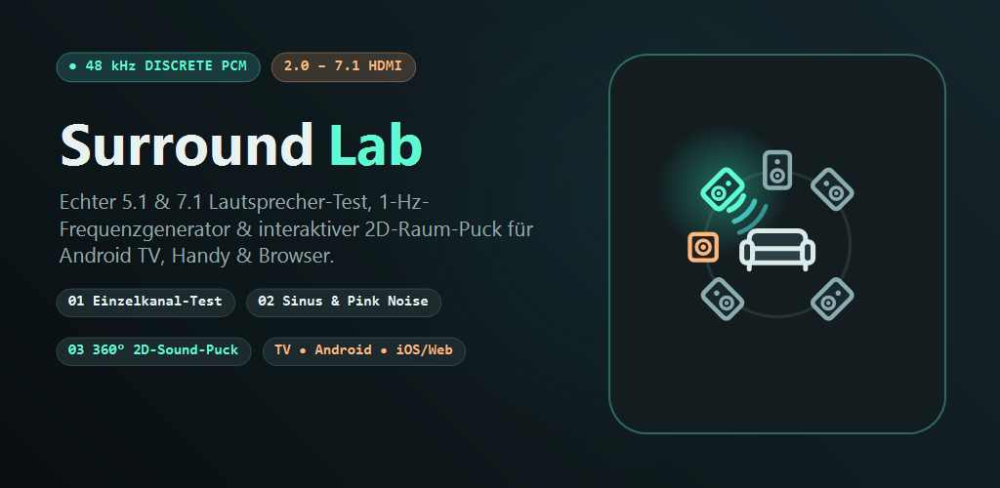
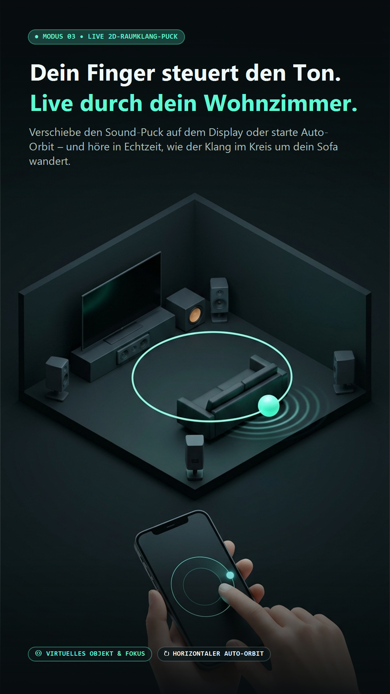
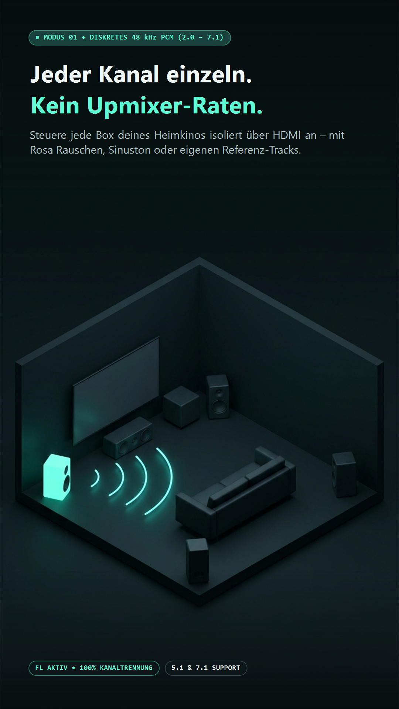
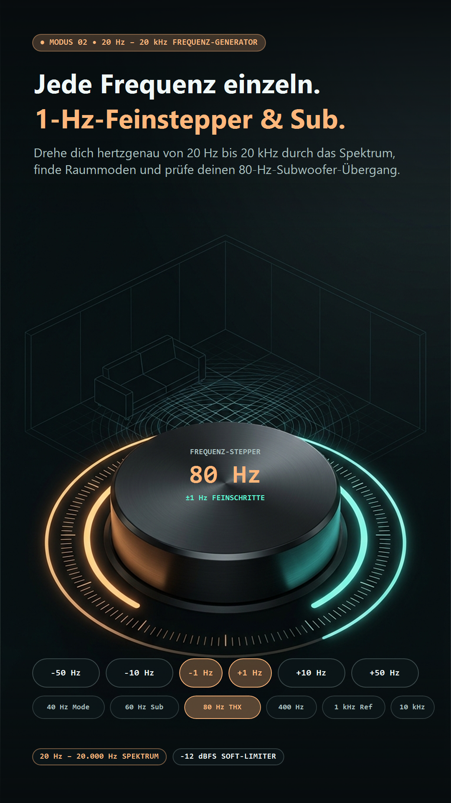
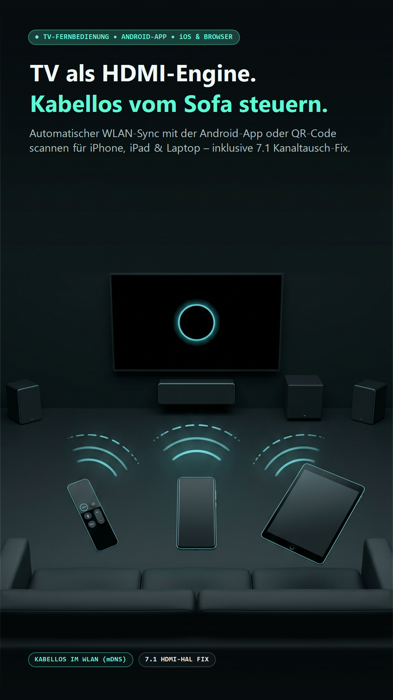
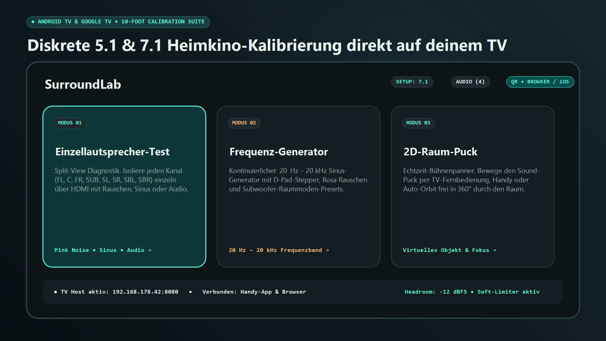
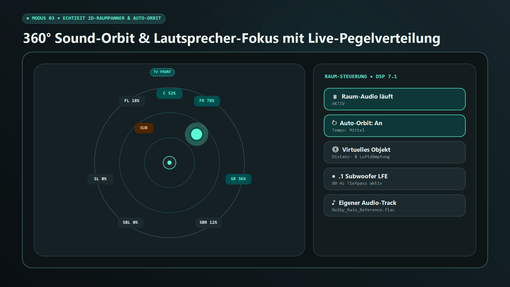

<p align="center">
  <a href="README.md">English</a> |
  <strong>Deutsch</strong> |
  <a href="README.es.md">Español</a> |
  <a href="README.fr.md">Français</a> |
  <a href="README.pt.md">Português</a> |
  <a href="README.ja.md">日本語</a>
</p>

<p align="center">
  
</p>

<h1 align="center">SurroundLab — Diskreter 5.1 &amp; 7.1 Heimkino-Test &amp; 2D-Raumklang-Bühne</h1>

<p align="center">
  <strong>Android TV / Google TV • Android-Smartphone • Browser &amp; iOS Web-Steuerung</strong><br/>
  <em>Echter 48-kHz-Mehrkanal-PCM-Stream über HDMI/eARC — kein Upmixer-Raten.</em>
</p>

---

## Warum SurroundLab?

Wer ein Heimkino mit AV-Receiver einrichtet, kennt das Problem: Man sucht auf YouTube nach einem *„5.1 oder 7.1 Surround Test“* – und bekommt in Wahrheit fast immer ein Stereo-Signal, das der Receiver per Upmixer irgendwie auf alle Boxen verteilt. Echtes 7.1 gibt es dort gar nicht. Man weiß nie sicher, ob wirklich jeder Kanal einzeln über HDMI ankommt.

**SurroundLab** ist aus genau diesem Frust im eigenen Heimkino entstanden: Ein ehrliches, präzises Akustik-Werkzeug für **Android TV, Google TV und Smartphones** – zum sauberen Prüfen deiner Anlage und zum Ausprobieren, was dein Raumklang-Setup wirklich kann.

Statt komprimierter Videos erzeugt die App auf dem TV in Echtzeit einen diskreten **48-kHz-Mehrkanal-PCM-Stream (2.0 bis 7.1)** direkt über HDMI/eARC. Auf allen nicht gewählten Kanälen liegt absolute digitale Stille (`0.0f`) an. Wenn hinten links spielt, wird auch wirklich nur hinten links angesteuert.

---

## Vorschau

<table>
  <tr>
    <td align="center"></td>
    <td align="center"></td>
    <td align="center"></td>
    <td align="center"></td>
  </tr>
</table>

<table>
  <tr>
    <td align="center"></td>
    <td align="center"></td>
  </tr>
</table>

---

## Die 3 Kern-Modi

- **01 — Einzellautsprecher-Test:** Schalte jeden Lautsprecher deines `2.0`-, `2.1`-, `3.1`-, `5.0`-, `5.1`- oder `7.1`-Systems einzeln frei. Wähle pro Kanal zwischen **Rosa Rauschen**, reinem **Sinuston** oder einer **eigenen Audiodatei**, um Verkabelung, Pegel und Klangfarbe zu prüfen.
- **02 — Frequenz- & Preset-Generator:** Durchfahre das Spektrum von **20 Hz bis 20 kHz** in feinen **1-Hz-Schritten**. Finde dröhnende Raummoden, klappernde Möbel oder prüfe mit den Direkt-Presets (`40 Hz`, `60 Hz`, `80 Hz THX-Crossover`, `400 Hz`, `1 kHz Referenz`, `10 kHz`) den Übergang zwischen Subwoofer und Satelliten.
- **03 — 2D-Raum-Puck (Live-Raumpanner):** Hier trifft Einmessung auf Hörspaß. Verschiebe eine Klangquelle in Echtzeit frei durch dein Wohnzimmer oder lass sie im **Auto-Orbit** (Langsam, Mittel, Schnell) kreisen. Schalte um zwischen *Virtuellem Objekt* (mit realistischer Distanz- und Luftdämpfung) und *Lautsprecher-Fokus*.

---

## 3 Wege zur Steuerung vom Sofa aus

1. **Direkt am Fernseher:** Komplett mit der TV-Fernbedienung (Steuerkreuz) bedienbar.
2. **Android-App-Koppelung (Automatisch):** Installiere dieselbe Universal-APK auf deinem Android-Handy. Beide Geräte finden sich im selben WLAN automatisch ohne QR-Code (`mDNS`), synchronisieren alle Einstellungen live und übertragen eigene Referenz-Tracks direkt auf den TV.
3. **Browser & iOS per QR-Code:** Du nutzt ein iPhone, iPad oder einen Laptop? Einfach den QR-Code oben rechts am TV scannen und das komplette Live-Steuerpult direkt im Browser öffnen – ohne Zusatz-App.

---

## Aus der Praxis für Heimkino-Enthusiasten

- **7.1-Kanaltausch-Fix:** Viele TV-Sticks (z. B. Chromecast / Amlogic) vertauschen bei 7.1 seitliche Surrounds (`SL/SR`) und Back-Surrounds (`SBL/SBR`). Ein Schalter in den Einstellungen behebt das sofort.
- **Anpassbare Raumgeometrie:** Wähle zwischen **Eng (±22°)**, **Standard (±30° Dolby/ITU)** und **Breit (±40°)**, passend zu deinem Wohnzimmer.
- **Gehör- & Hochtönerschutz:** Startet sicher bei **-12 dBFS** Headroom mit integriertem Soft-Clip-Limiter (`±0.98f`) und sanften 15-ms-Ein-/Ausblendrampen – kein Knacksen, kein Clipping.
- **Eigene Audio-Tracks:** Lade eigene `.wav`-, `.mp3`-, `.flac`- oder `.ogg`-Dateien (bis 30 MB) hoch und schicke sie auf eine 360°-Reise durch den Raum.
- **Datenschutz ohne Ballast:** Keine Werbung, kein Abo, kein Konto-Zwang und keinerlei Standort- oder Speicher-Vollzugriffsberechtigungen.

---

## Download & Installation

SurroundLab wird als **einzige Universal-APK** ausgeliefert, die sowohl auf Android-Smartphones als auch auf Android TV / Google TV läuft.

### Auf dem Android-Smartphone
1. Öffne auf deinem Handy die Seite [**Latest Release**](https://github.com/irohmaniac/SurroundLab/releases/latest).
2. Lade **`SurroundLab.apk`** herunter und installiere die App.

### Auf dem Chromecast / Google TV / Android TV (ohne PC)
1. Öffne am Fernseher den **Google Play Store**, suche nach **„Downloader by AFTVnews“** (oranges Symbol) und installiere die kostenlose App.
2. Öffne **Downloader** am TV und gib folgende Download-Adresse ein:
   ```text
   https://github.com/irohmaniac/SurroundLab/releases/latest/download/SurroundLab.apk
   ```
3. Falls dein TV einmalig nach der Berechtigung fragt, gehe auf **Einstellungen → Zulassen** und tippe anschließend auf **Installieren**.
4. Öffne **SurroundLab** auf dem Fernseher. Sobald TV und Handy im selben WLAN sind, verbinden sie sich vollautomatisch.

---

## Selbst kompilieren

```bash
git clone https://github.com/irohmaniac/SurroundLab.git
cd SurroundLab
./gradlew assembleDebug
```
Die Universal-APK landet unter `app/build/outputs/apk/debug/app-debug.apk` (Android 8.0 / API 26+).
