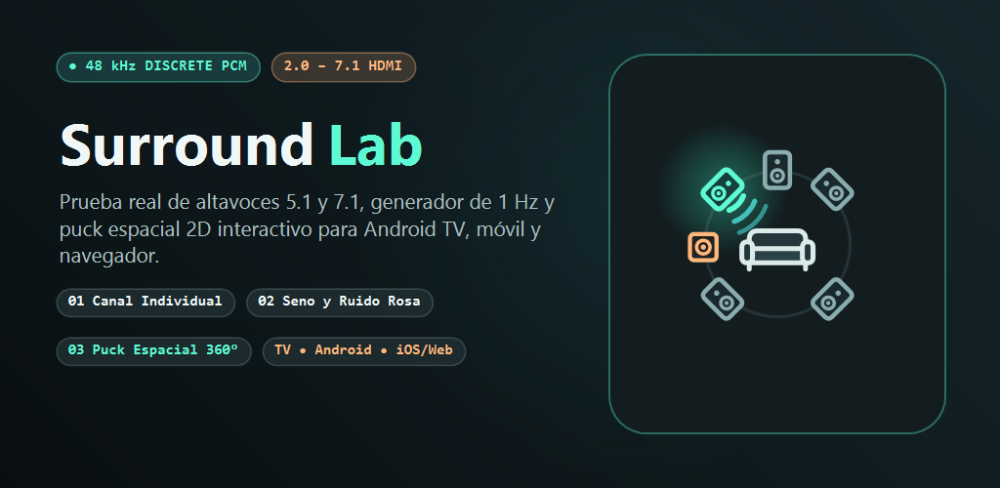
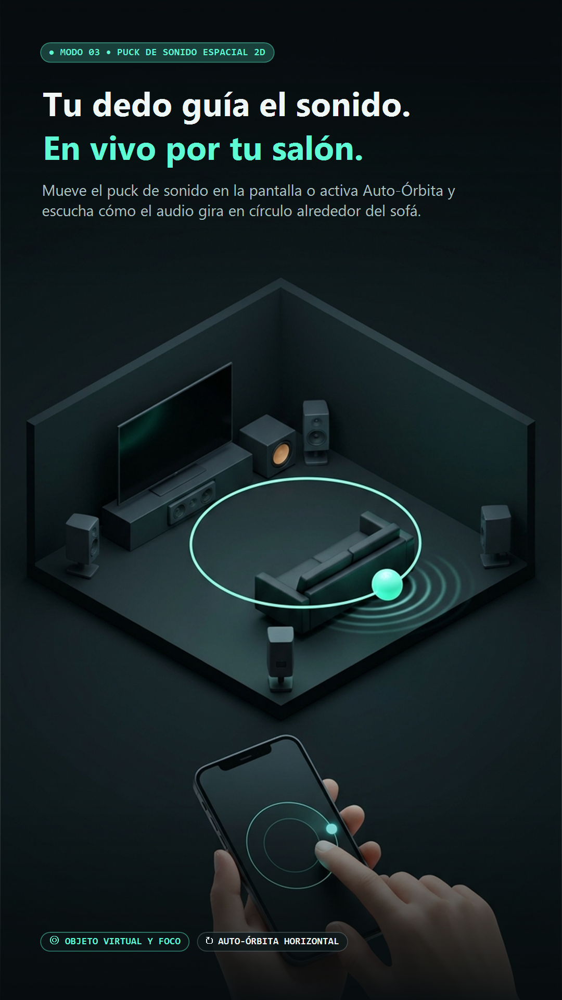
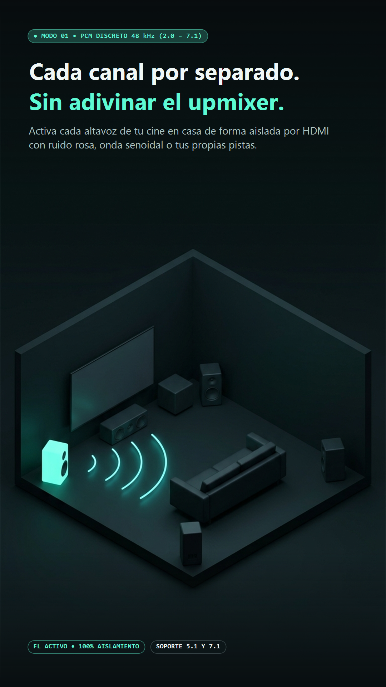
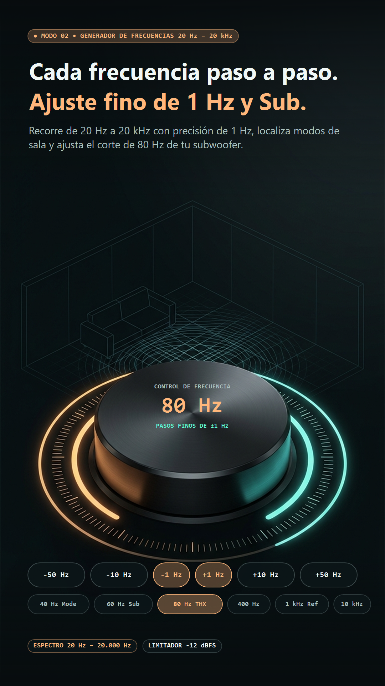
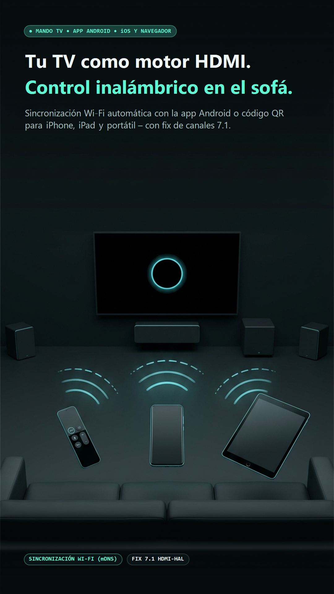
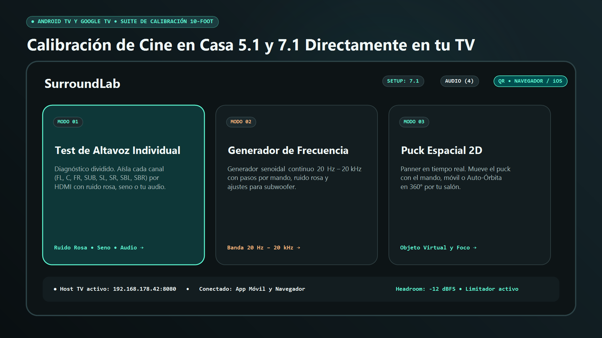
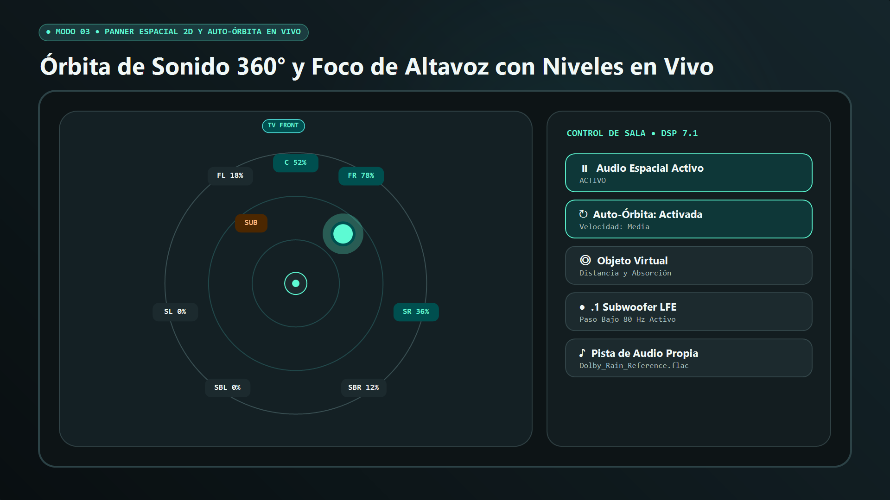

<p align="center">
  <a href="README.md">English</a> |
  <a href="README.de.md">Deutsch</a> |
  <strong>Español</strong> |
  <a href="README.fr.md">Français</a> |
  <a href="README.pt.md">Português</a> |
  <a href="README.ja.md">日本語</a>
</p>

<p align="center">
  
</p>

<h1 align="center">SurroundLab — Prueba Discreta 5.1 y 7.1 para Cine en Casa y Escenario Espacial 2D</h1>

<p align="center">
  <strong>Android TV / Google TV • Móvil Android • Control Web para Navegador e iOS</strong><br/>
  <em>Audio PCM multicanal discreto a 48 kHz por HDMI/eARC — sin engaños de upmixer.</em>
</p>

---

## ¿Por qué SurroundLab?

Cualquiera que haya montado un cine en casa con un receptor AV conoce la frustración: buscas en YouTube un *«test surround 5.1 o 7.1»* y casi siempre recibes una señal estéreo 2.0 que tu receptor reparte artificialmente. El 7.1 discreto real ni siquiera existe en YouTube.

**SurroundLab** nació exactamente de esa frustración en mi propio salón: una herramienta acústica precisa y honesta para **Android TV, Google TV y smartphones Android**, pensada tanto para comprobar tu calibración como para disfrutar probando lo que tu sistema surround puede hacer.

En lugar de vídeos comprimidos, SurroundLab abre en tiempo real un flujo **PCM multicanal discreto a 48 kHz (de 2.0 hasta 7.1)** directamente por HDMI/eARC. Los canales inactivos reciben silencio digital puro (`0.0f`).

---

## Vista Previa

<table>
  <tr>
    <td align="center"></td>
    <td align="center"></td>
    <td align="center"></td>
    <td align="center"></td>
  </tr>
</table>

<table>
  <tr>
    <td align="center"></td>
    <td align="center"></td>
  </tr>
</table>

---

## Los 3 Modos Principales

- **01 — Prueba de Altavoz Individual:** Aísla cada canal de tu sistema `2.0`, `2.1`, `3.1`, `5.0`, `5.1` o `7.1`. Elige entre **Ruido Rosa**, **Onda Senoidal** o tu **propia pista de audio** para verificar cableado y niveles.
- **02 — Generador de Frecuencias y Presets:** Recorre de **20 Hz a 20 kHz** en pasos finos de **1 Hz**. Localiza modos de sala y ajusta el corte de tu subwoofer (`40 Hz`, `60 Hz`, `80 Hz THX`, `400 Hz`, `1 kHz`, `10 kHz`).
- **03 — Puck Espacial 2D:** Mueve un objeto sonoro en tiempo real por tu salón o activa la **Auto-Órbita** (Lento, Medio, Rápido) y alterna entre *Objeto Virtual* y *Foco de Altavoz*.

---

## Descarga e Instalación

### En Móvil Android
1. Abre la página [**Latest Release**](https://github.com/irohmaniac/SurroundLab/releases/latest).
2. Descarga e instala **`SurroundLab.apk`**.

### En Chromecast / Google TV / Android TV (sin PC)
1. Abre **Google Play Store** en tu TV, busca **«Downloader by AFTVnews»** (icono naranja) e instálala.
2. Abre **Downloader** e introduce la URL directa:
   ```text
   https://github.com/irohmaniac/SurroundLab/releases/latest/download/SurroundLab.apk
   ```
3. Si tu TV solicita permiso para instalar apps desde Downloader, selecciona **Ajustes → Permitir** y pulsa **Instalar**.
4. Abre **SurroundLab** en el televisor. Cuando la TV y el móvil estén en el mismo Wi-Fi, se conectarán automáticamente.
