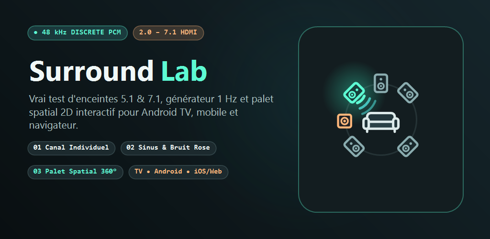
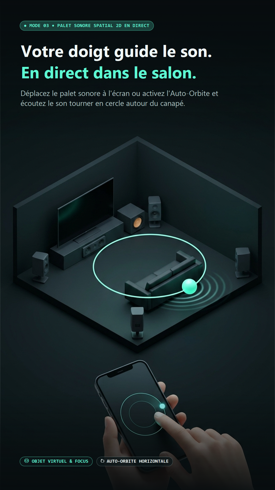
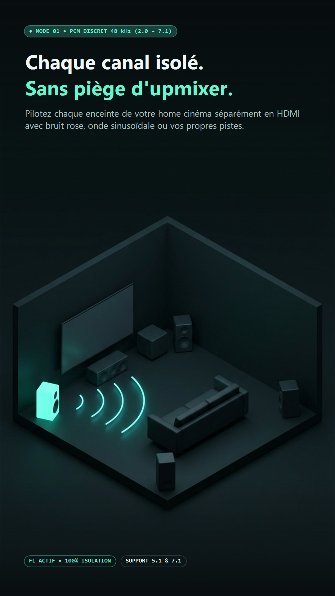
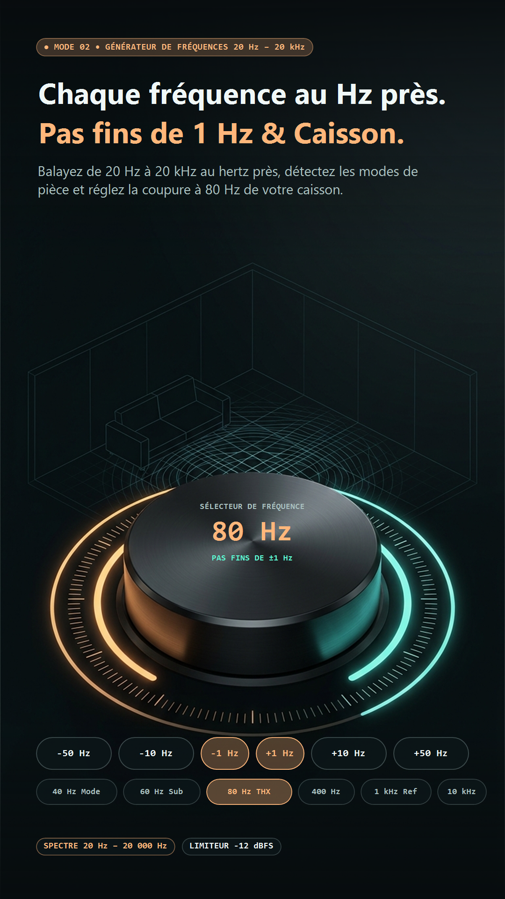
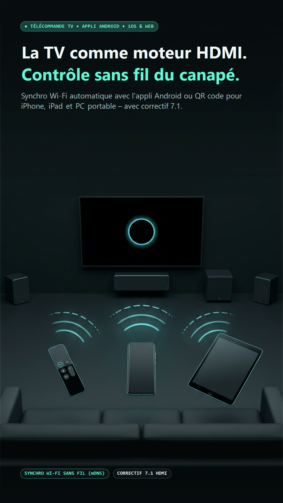
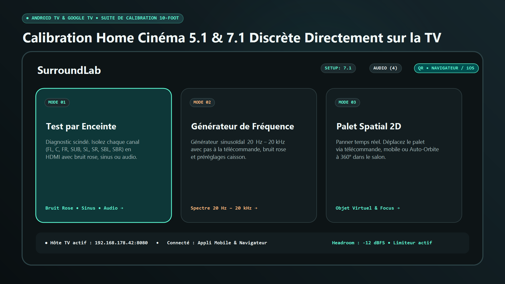
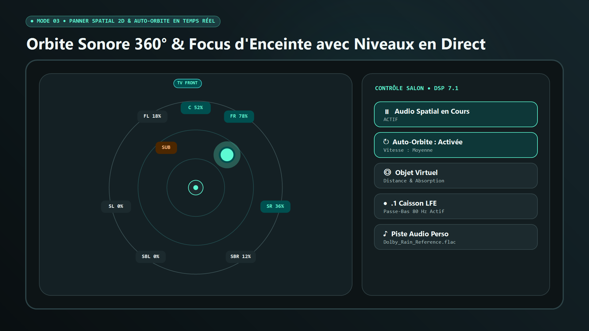

<p align="center">
  <a href="README.md">English</a> |
  <a href="README.de.md">Deutsch</a> |
  <a href="README.es.md">Español</a> |
  <strong>Français</strong> |
  <a href="README.pt.md">Português</a> |
  <a href="README.ja.md">日本語</a>
</p>

<p align="center">
  
</p>

<h1 align="center">SurroundLab — Test Home Cinéma 5.1 &amp; 7.1 Discret et Scène Sonore Spatiale 2D</h1>

<p align="center">
  <strong>Android TV / Google TV • Smartphone Android • Contrôle Web Navigateur &amp; iOS</strong><br/>
  <em>Véritable flux PCM multicanal 48 kHz via HDMI/eARC — sans upmixer trompeur.</em>
</p>

---

## Pourquoi SurroundLab ?

Quiconque a déjà configuré un home cinéma connaît la frustration : vous cherchez sur YouTube un *« test surround 5.1 ou 7.1 »* et recevez presque toujours un flux stéréo 2.0 redistribué artificiellement par l'ampli. Le vrai 7.1 discret n'existe même pas sur YouTube.

**SurroundLab** est né de cette frustration dans mon propre salon : un outil acoustique précis et honnête pour **Android TV, Google TV et smartphones Android**, conçu autant pour vérifier votre calibration que pour explorer ce que votre installation sait vraiment faire.

Au lieu de vidéos compressées, SurroundLab ouvre en temps réel un flux **PCM multicanal discret à 48 kHz (2.0 jusqu'à 7.1)** directement via HDMI/eARC. Les canaux non sélectionnés reçoivent un silence numérique pur (`0.0f`).

---

## Aperçu

<table>
  <tr>
    <td align="center"></td>
    <td align="center"></td>
    <td align="center"></td>
    <td align="center"></td>
  </tr>
</table>

<table>
  <tr>
    <td align="center"></td>
    <td align="center"></td>
  </tr>
</table>

---

## Les 3 Modes Principaux

- **01 — Test par Enceinte :** Isolez chaque canal de votre système `2.0`, `2.1`, `3.1`, `5.0`, `5.1` ou `7.1`. Choisissez entre **Bruit Rose**, **Onde Sinusoïdale** ou votre **propre piste audio** pour vérifier câblage et niveaux.
- **02 — Générateur de Fréquences & Préréglages :** Balayez de **20 Hz à 20 kHz** par pas fins de **1 Hz**. Détectez les résonances de pièce et réglez la coupure caisson (`40 Hz`, `60 Hz`, `80 Hz THX`, `400 Hz`, `1 kHz`, `10 kHz`).
- **03 — Palet Spatial 2D :** Déplacez une source sonore en temps réel dans votre salon ou activez l'**Auto-Orbite** (Lent, Moyen, Rapide) et alternez entre *Objet Virtuel* et *Focus Enceinte*.

---

## Téléchargement & Installation

### Sur Smartphone Android
1. Ouvrez la page [**Latest Release**](https://github.com/irohmaniac/SurroundLab/releases/latest).
2. Téléchargez et installez **`SurroundLab.apk`**.

### Sur Chromecast / Google TV / Android TV (sans PC)
1. Sur votre TV, ouvrez le **Google Play Store**, cherchez **« Downloader by AFTVnews »** (icône orange) et installez l'application.
2. Ouvrez **Downloader** et saisissez l'URL directe :
   ```text
   https://github.com/irohmaniac/SurroundLab/releases/latest/download/SurroundLab.apk
   ```
3. Si Android TV demande l'autorisation pour Downloader, allez dans **Paramètres → Autoriser**, puis cliquez sur **Installer**.
4. Lancez **SurroundLab** sur la TV. Dès que la TV et le téléphone sont sur le même Wi-Fi, ils se connectent automatiquement.
