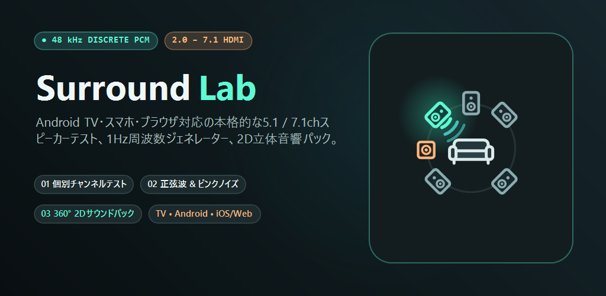
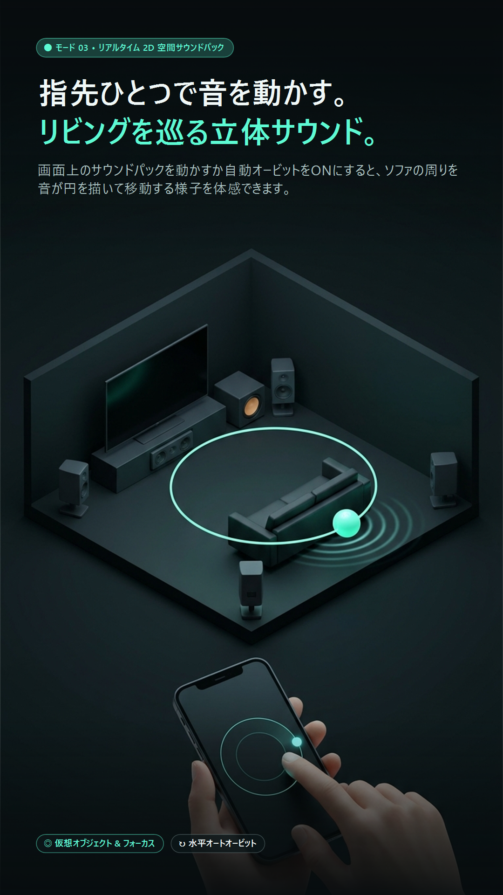
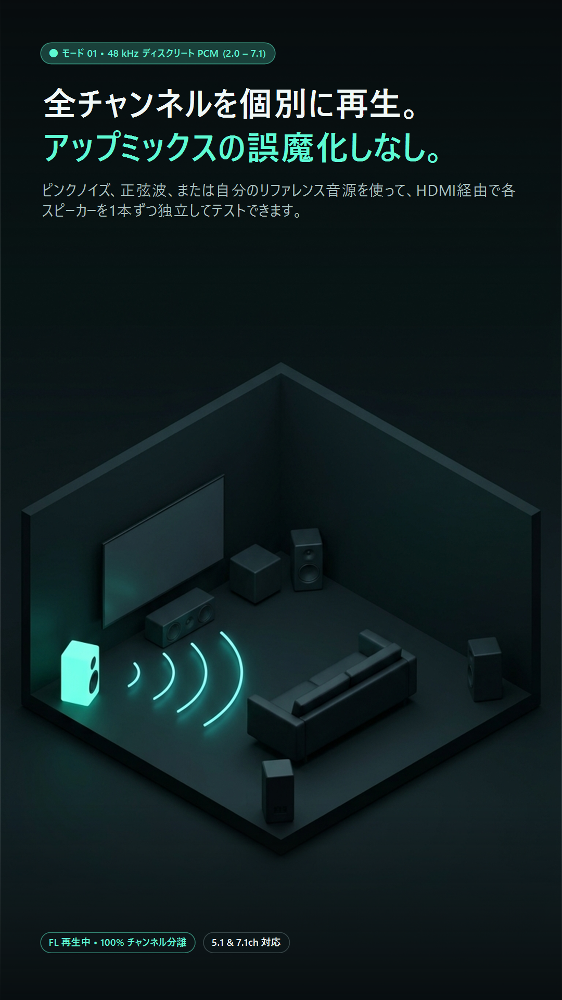
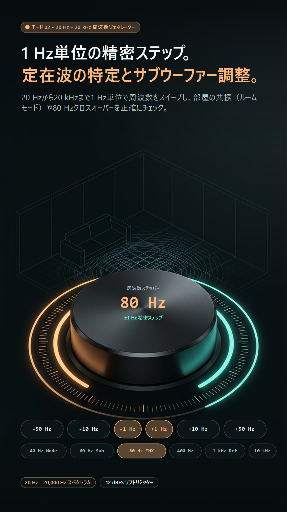
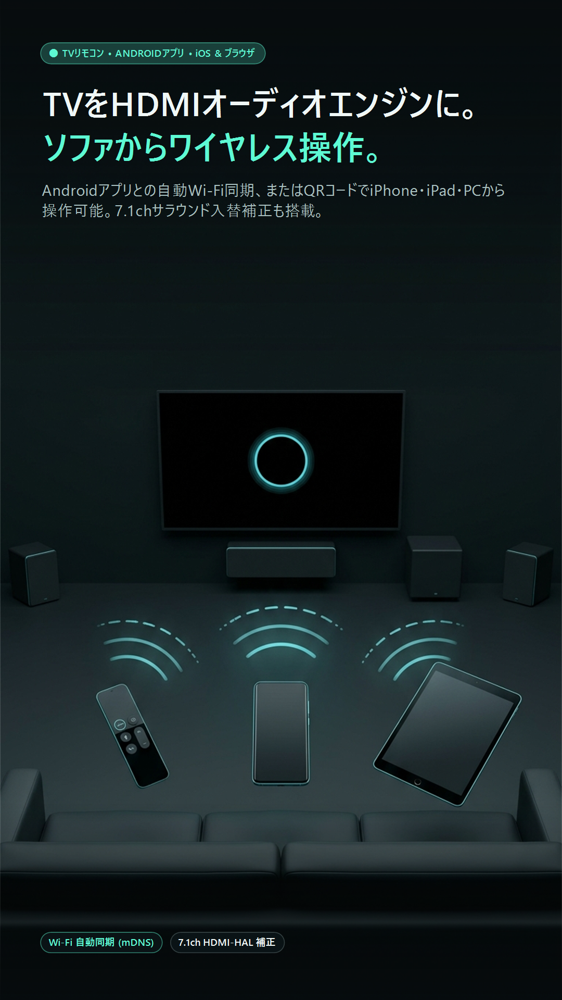
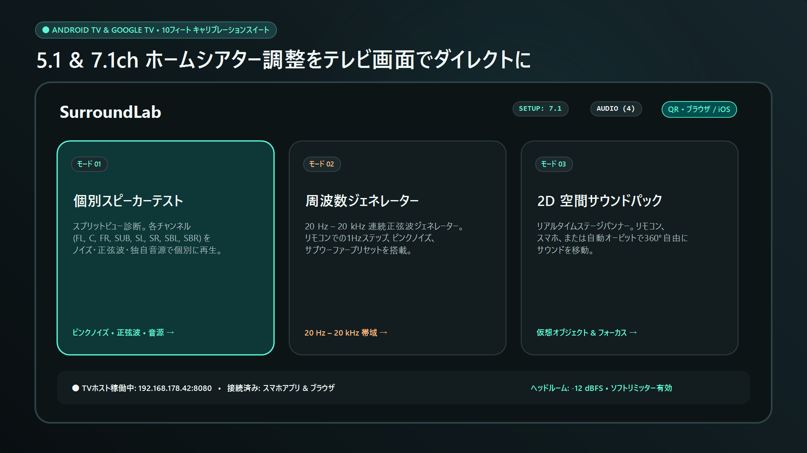
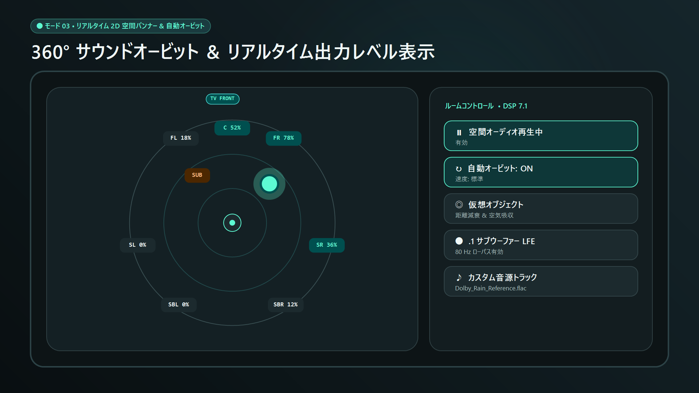

<p align="center">
  <a href="README.md">English</a> |
  <a href="README.de.md">Deutsch</a> |
  <a href="README.es.md">Español</a> |
  <a href="README.fr.md">Français</a> |
  <a href="README.pt.md">Português</a> |
  <strong>日本語</strong>
</p>

<p align="center">
  
</p>

<h1 align="center">SurroundLab — ディスクリート 5.1 / 7.1ch ホームシアター調整 &amp; 2D立体音響ステージ</h1>

<p align="center">
  <strong>Android TV / Google TV • Android スマホ • ブラウザ &amp; iOS Web リモコン対応</strong><br/>
  <em>HDMI / eARC 経由の本物の 48 kHz マルチチャンネル PCM 出力 — アップミックスの誤魔化しなし。</em>
</p>

---

## SurroundLab とは？

AV アンプでホームシアターを組んだ方なら一度は経験する悩みがあります。YouTube で「5.1ch / 7.1ch サラウンドテスト」を検索しても、実際には 2.0ch ステレオ音声で、AV アンプのアップミキサーが勝手に全スピーカーへ振り分けているだけ。本物のディスクリート 7.1ch テスト動画は YouTube に存在すらしません。

**SurroundLab** は、まさにその自宅シアターでの不満から生まれた、**Android TV・Google TV・スマートフォン**向けの本格アコースティック・ツールキットです。正確なスピーカー調整だけでなく、サラウンドシステムの実力を体感して楽しむこともできます。

圧縮動画ではなく、HDMI / eARC 経由でリアルタイムに **48 kHz ディスクリート・マルチチャンネル PCM ストリーム（2.0 ～ 7.1ch）** を直接生成。選択されていないチャンネルには純粋なデジタル無音（`0.0f`）が送られます。

---

## スクリーンショット

<table>
  <tr>
    <td align="center"></td>
    <td align="center"></td>
    <td align="center"></td>
    <td align="center"></td>
  </tr>
</table>

<table>
  <tr>
    <td align="center"></td>
    <td align="center"></td>
  </tr>
</table>

---

## 3 つのコアモード

- **01 — 個別スピーカーテスト:** `2.0` ～ `7.1ch` の各チャンネルを 1 本ずつ個別に再生。**ピンクノイズ**、**正弦波**、または**手持ちの音源ファイル**で配線や音圧バランスを確認できます。
- **02 — 周波数＆プリセットジェネレーター:** **20 Hz ～ 20 kHz** を **1 Hz 単位**で精密スイープ。部屋の共振（ルームモード）や 80 Hz クロスオーバーを素早くチェックできます。
- **03 — 2D 空間サウンドパック:** リビングで音源を 360° リアルタイムに移動させたり、**自動オービット**（低速 / 標準 / 高速）でソファの周りを周回させたりできます。

---

## ダウンロードとインストール

### Android スマートフォン
1. [**Latest Release**](https://github.com/irohmaniac/SurroundLab/releases/latest) ページを開きます。
2. **`SurroundLab.apk`** をダウンロードしてインストールします。

### Chromecast / Google TV / Android TV（PC 不要）
1. テレビの **Google Play ストア**で **「Downloader by AFTVnews」**（オレンジ色のアイコン）を検索してインストールします。
2. テレビで **Downloader** を開き、コード **`7281113`**（または下の直接 URL）を入力して **Go** を押します：
   ```text
   7281113
   ```
   *(直接 URL: `https://github.com/irohmaniac/SurroundLab/releases/latest/download/SurroundLab.apk`)*
3. インストール許可を求められたら **「設定」→「許可」** をオンにして **「インストール」** を押します。
4. テレビで **SurroundLab** を起動します。同じ Wi-Fi にあればスマホと自動的に接続されます。
