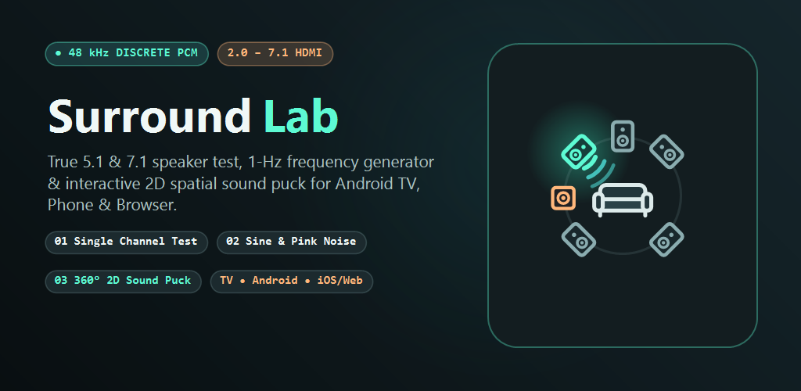
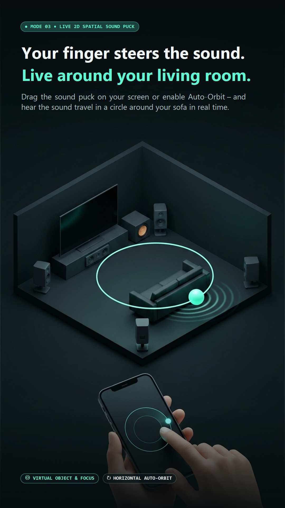
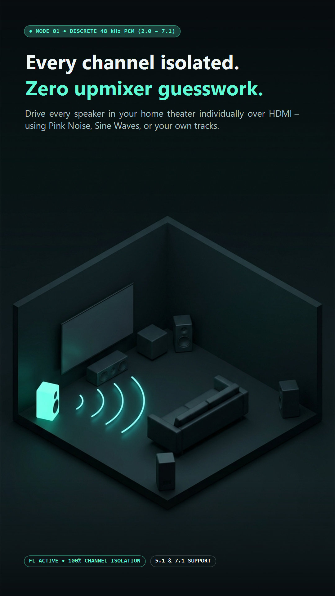
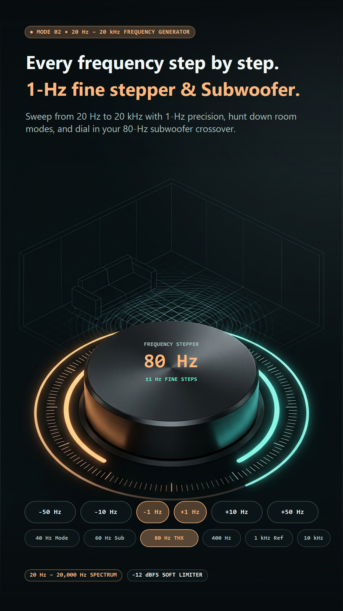
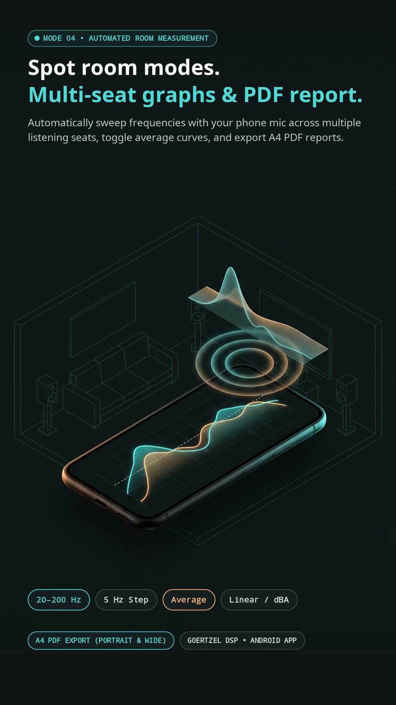
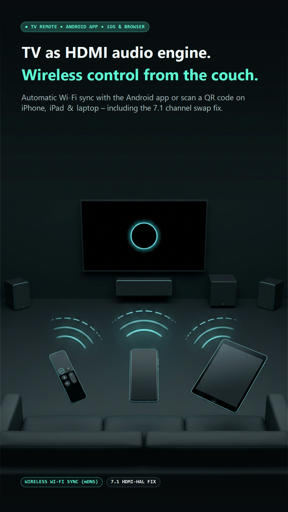
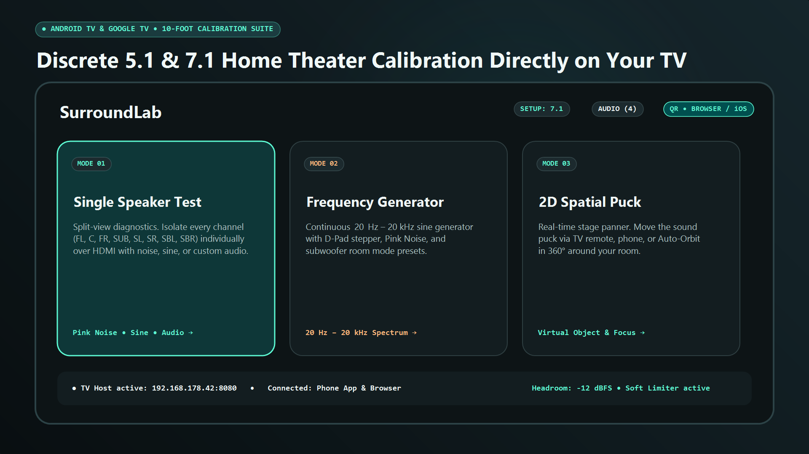
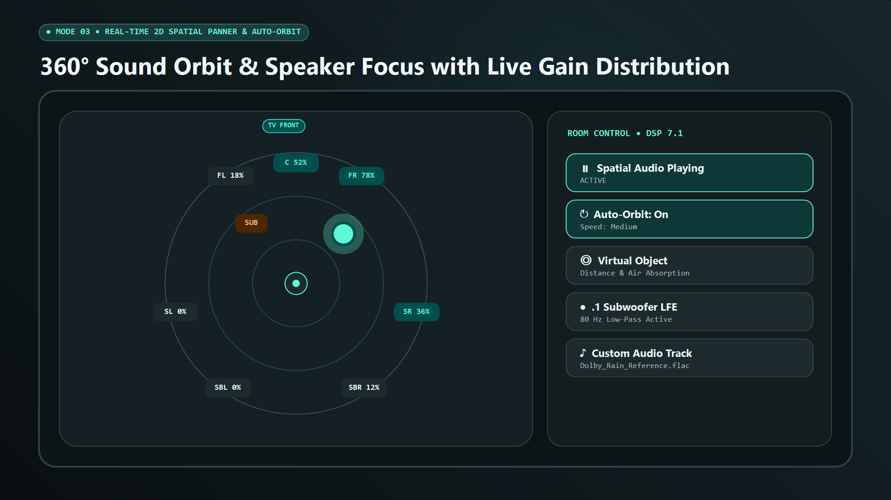

<p align="center">
  <strong>English</strong> |
  <a href="README.de.md">Deutsch</a> |
  <a href="README.es.md">Español</a> |
  <a href="README.fr.md">Français</a> |
  <a href="README.pt.md">Português</a> |
  <a href="README.ja.md">日本語</a>
</p>

<p align="center">
  
</p>

<h1 align="center">SurroundLab — Discrete 5.1 &amp; 7.1 Home Theater Calibration &amp; Spatial Sound Stage</h1>

<p align="center">
  <strong>Android TV / Google TV • Android Smartphone • Browser &amp; iOS Web Remote</strong><br/>
  <em>True 48 kHz multichannel PCM over HDMI/eARC — zero upmixer guesswork.</em>
</p>

---

## Why SurroundLab?

Anyone who has ever set up a home theater with an AV receiver knows the frustration: you search YouTube for a *"5.1 or 7.1 surround test,"* only to get a 2.0 stereo stream that your receiver's upmixer spreads across all speakers. True discrete 7.1 doesn't even exist on YouTube. You are left guessing whether discrete multichannel audio is actually working over HDMI.

**SurroundLab** was built out of that exact frustration for my own living room setup: an honest, precision acoustic toolkit for **Android TV, Google TV, and Android smartphones**—designed both to verify your calibration and to actually have fun exploring what your surround system can do.

Instead of playing compressed video files, SurroundLab opens a real-time, discrete **48 kHz multichannel PCM stream (2.0 up to 7.1)** directly over HDMI/eARC. Unused channels receive pure digital silence (`0.0f`). When you trigger Rear Left, only Rear Left receives a signal.

---

## Showcase

<table>
  <tr>
    <td align="center"></td>
    <td align="center"></td>
    <td align="center"></td>
    <td align="center"></td>
    <td align="center"></td>
  </tr>
</table>

<table>
  <tr>
    <td align="center"></td>
    <td align="center"></td>
  </tr>
</table>

---

## Four Core Modes

- **01 — Single Speaker Test:** Isolate every channel of your `2.0`, `2.1`, `3.1`, `5.0`, `5.1`, or `7.1` system individually. Choose between **Pink Noise**, a pure **Sine Wave**, or your **own uploaded audio track** per channel to verify wiring, trim levels, and speaker timbre.
- **02 — Frequency & Preset Generator:** Sweep continuously from **20 Hz to 20 kHz** with **1 Hz precision**. Track down room modes, cabinet rattles, or test your subwoofer integration using quick presets (`40 Hz`, `60 Hz`, `80 Hz THX Crossover`, `400 Hz`, `1 kHz Reference`, `10 kHz`) and speaker groups including *All Except Subwoofer*.
- **03 — 2D Spatial Sound Puck:** Where serious calibration meets pure listening fun. Drag a sound source smoothly around your room in real time or let it circle automatically with **Auto-Orbit** (Slow, Medium, Fast). Switch between *Virtual Object* (simulating natural distance & air attenuation) and *Speaker Focus* to hear how seamlessly your speakers blend across the room.
- **04 — Room Modes & Automated Sweep (Android App):** Turn your Android smartphone into an acoustic measurement mic at your listening seat (works both connected to your TV host and standalone via cable/Bluetooth). Includes a pre-sweep **Level Check**, narrowband **Goertzel** analysis resistant to background noise, custom linear (Hz) or logarithmic (octave) sweeps, multiple color-coded listening positions with per-seat visibility toggles and an optional **Spatial Average** curve, non-destructive **Linear (Flat) / dBA** switching, run comparisons, and **DIN A4 PDF export** (3 compact runs per portrait page or wide landscape for single runs). *(Note: Browser/iOS web control disables this mode because mobile browsers block microphone access over plain local Wi-Fi HTTP.)*

---

## Three Ways to Control from Your Couch

1. **Directly on TV:** Fully navigable with your standard TV remote (D-Pad).
2. **Android App Auto-Sync:** Install the same universal APK on your Android phone. Both devices discover each other automatically over Wi-Fi (`mDNS`) with zero QR scanning, sync every setting live, and transfer your custom reference audio files straight to the TV.
3. **Browser & iOS via QR Code:** Using an iPhone, iPad, or laptop? Scan the QR code shown on your TV to open the full real-time web controller right in your mobile browser—no extra app install required.

---

## Built by an Enthusiast, for Enthusiasts

- **7.1 HDMI Channel-Swap Fix:** Many Android TV sticks (such as Chromecast / Amlogic devices) swap Side Surrounds (`SL/SR`) and Rear Surrounds (`SBL/SBR`) in 7.1 hardware output. A single toggle in Settings fixes the mapping instantly.
- **Adjustable Room Geometry:** Match your actual speaker placement with **Narrow (±22°)**, **Standard (±30° Dolby/ITU)**, or **Wide (±40°)** angle presets.
- **Configurable LFE Low-Pass & Hearing Protection:** Starts safely at **-12 dBFS** digital headroom with an always-on soft-clip limiter (`±0.98f`) and smooth 15 ms raised-cosine fades. The subwoofer (`.1`) low-pass for Pink Noise & Music is configurable (`80–200 Hz` or `Direct`, default `120 Hz`), while pure sine waves and room sweeps always bypass directly to your AVR crossover.
- **Custom Reference Audio:** Upload your own `.wav`, `.mp3`, `.flac`, or `.ogg` tracks (up to 30 MB) and send them on a 360° orbit around your sofa.
- **Zero Bloat & Minimal Permissions:** No ads, no subscriptions, no account required, and no location or broad storage permissions. Microphone access (`RECORD_AUDIO`) is requested only when you run the Room Mode measurement on your phone.

---

## Download & Installation

SurroundLab is distributed as a **single universal APK** that runs on both Android smartphones and Android TV / Google TV devices.

### On Android Smartphone
1. Open the [**Latest Release**](https://github.com/irohmaniac/SurroundLab/releases/latest) page on your phone.
2. Download and install **`SurroundLab.apk`**.

### On Chromecast / Google TV / Android TV (No PC Required)
1. On your TV, open the **Google Play Store**, search for **“Downloader by AFTVnews”** (orange icon), and install it.
2. Open **Downloader** on your TV, enter the short code **`7281113`** (or the direct URL below), and press **Go**:
   ```text
   7281113
   ```
   *(Direct URL: `https://github.com/irohmaniac/SurroundLab/releases/latest/download/SurroundLab.apk`)*
3. If Android TV asks for permission to install apps from Downloader, select **Settings → Allow**, then tap **Install**.
4. Open **SurroundLab** on your TV. As soon as your TV and phone are on the same Wi-Fi, they connect automatically.

---

## Build from Source

```bash
git clone https://github.com/irohmaniac/SurroundLab.git
cd SurroundLab
./gradlew assembleDebug
```
The universal APK is written to `app/build/outputs/apk/debug/app-debug.apk` (Android 8.0 / API 26+).

---

## Transparency Note

This app—including its Kotlin/Compose codebase, real-time audio DSP engine, translations, and showcase graphics—was developed with the assistance of AI, guided, tested, and refined on real home theater hardware (Chromecast with Google TV, AV receiver, and Android smartphone).

