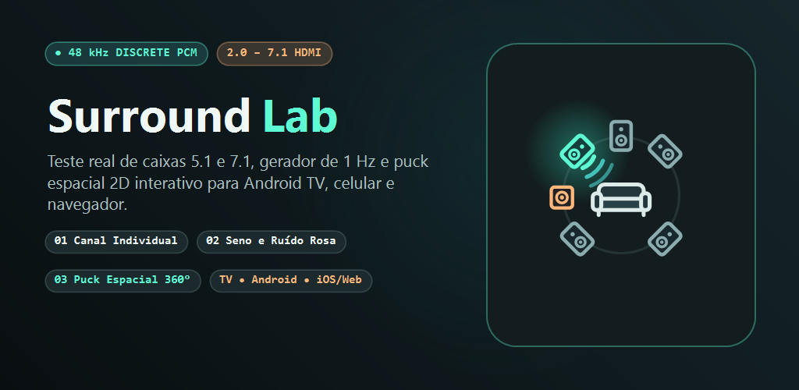
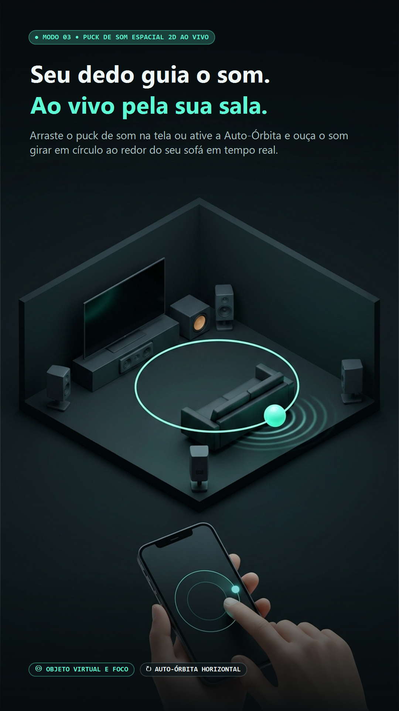
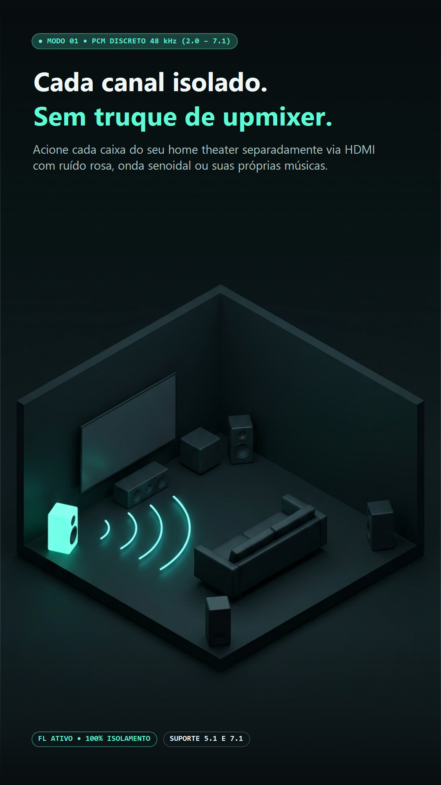
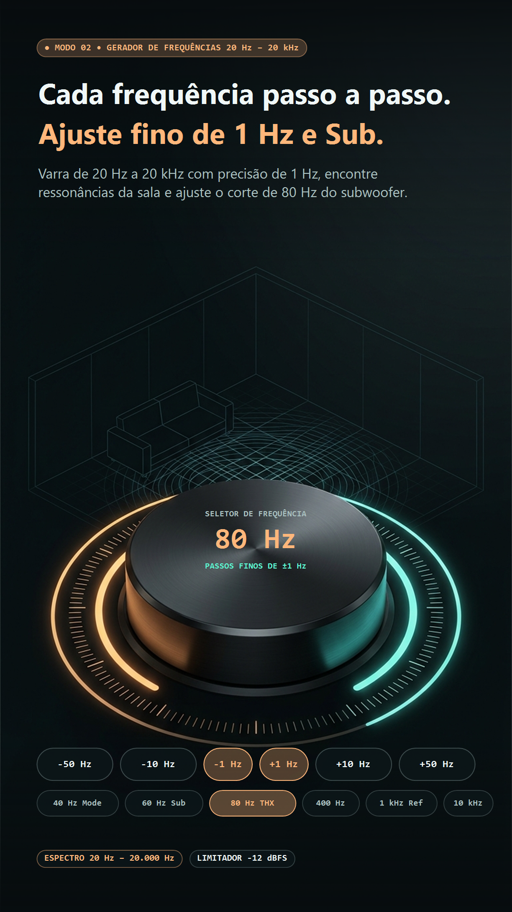
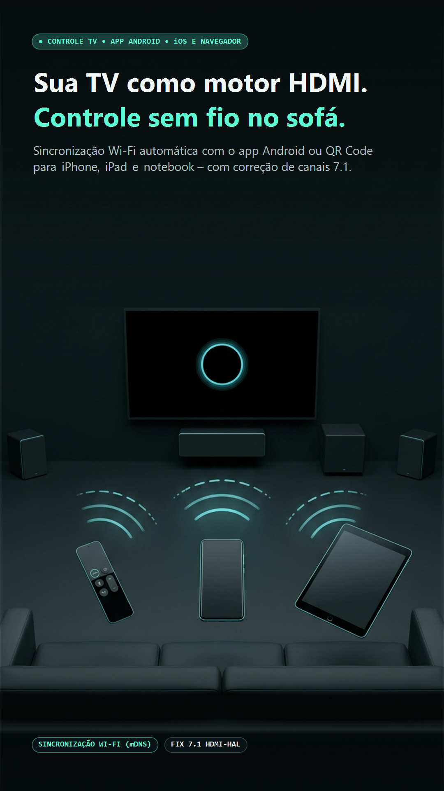
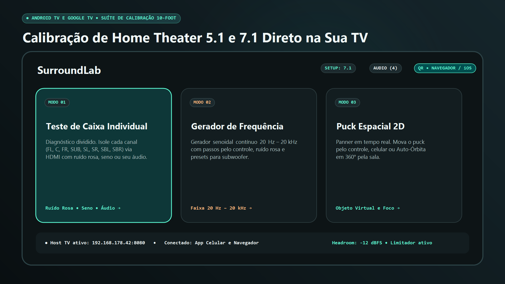
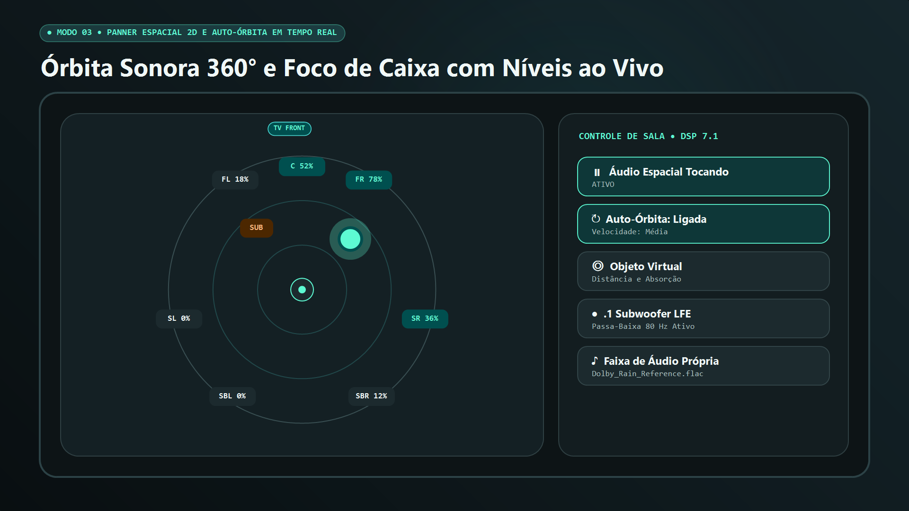

<p align="center">
  <a href="README.md">English</a> |
  <a href="README.de.md">Deutsch</a> |
  <a href="README.es.md">Español</a> |
  <a href="README.fr.md">Français</a> |
  <strong>Português</strong> |
  <a href="README.ja.md">日本語</a>
</p>

<p align="center">
  
</p>

<h1 align="center">SurroundLab — Teste Discreto 5.1 e 7.1 para Home Theater e Palco Espacial 2D</h1>

<p align="center">
  <strong>Android TV / Google TV • Smartphone Android • Controle Web para Navegador e iOS</strong><br/>
  <em>Áudio PCM multicanal discreto em 48 kHz via HDMI/eARC — sem truques de upmixer.</em>
</p>

---

## Por que o SurroundLab?

Quem já configurou um home theater com receiver AV conhece a frustração: você procura no YouTube um *“teste surround 5.1 ou 7.1”* e quase sempre recebe apenas áudio estéreo 2.0 espalhado artificialmente pelo receiver. O 7.1 discreto real nem sequer existe no YouTube.

O **SurroundLab** nasceu exatamente dessa frustração na minha própria sala: uma ferramenta acústica honesta e precisa para **Android TV, Google TV e smartphones Android**, feita tanto para conferir sua calibração quanto para se divertir explorando o que seu sistema surround consegue fazer.

Em vez de vídeos comprimidos, o SurroundLab abre em tempo real um fluxo **PCM multicanal discreto em 48 kHz (2.0 até 7.1)** diretamente via HDMI/eARC. Os canais inativos recebem silêncio digital puro (`0.0f`).

---

## Prévia

<table>
  <tr>
    <td align="center"></td>
    <td align="center"></td>
    <td align="center"></td>
    <td align="center"></td>
  </tr>
</table>

<table>
  <tr>
    <td align="center"></td>
    <td align="center"></td>
  </tr>
</table>

---

## Os 3 Modos Principais

- **01 — Teste de Caixa Individual:** Isole cada canal do seu sistema `2.0`, `2.1`, `3.1`, `5.0`, `5.1` ou `7.1`. Escolha entre **Ruído Rosa**, **Onda Senoidal** ou sua **própria faixa de áudio** para checar fiação e níveis.
- **02 — Gerador de Frequências e Presets:** Varra de **20 Hz a 20 kHz** com precisão de **1 Hz**. Encontre ressonâncias na sala e ajuste o corte do subwoofer (`40 Hz`, `60 Hz`, `80 Hz THX`, `400 Hz`, `1 kHz`, `10 kHz`).
- **03 — Puck Espacial 2D:** Mova uma fonte sonora em tempo real pela sala ou ative a **Auto-Órbita** (Lento, Médio, Rápido) e alterne entre *Objeto Virtual* e *Foco de Caixa*.

---

## Download e Instalação

### No Smartphone Android
1. Acesse a página [**Latest Release**](https://github.com/irohmaniac/SurroundLab/releases/latest).
2. Baixe e instale **`SurroundLab.apk`**.

### No Chromecast / Google TV / Android TV (sem PC)
1. Na sua TV, abra a **Google Play Store**, procure por **“Downloader by AFTVnews”** (ícone laranja) e instale o app.
2. Abra o **Downloader**, digite o código **`7281113`** (ou o link direto abaixo) e toque em **Go**:
   ```text
   7281113
   ```
   *(Link direto: `https://github.com/irohmaniac/SurroundLab/releases/latest/download/SurroundLab.apk`)*
3. Se a TV pedir permissão para instalar apps pelo Downloader, acesse **Configurações → Permitir** e toque em **Instalar**.
4. Abra o **SurroundLab** na TV. Assim que a TV e o celular estiverem no mesmo Wi-Fi, eles se conectam automaticamente.

---

## Nota de transparência

Este aplicativo — incluindo o código Kotlin/Compose, o motor de áudio em tempo real, as traduções e as imagens de apresentação — foi desenvolvido com auxílio de IA e testado e refinado em equipamentos reais de home theater (Chromecast com Google TV, receiver AV e smartphone Android).

